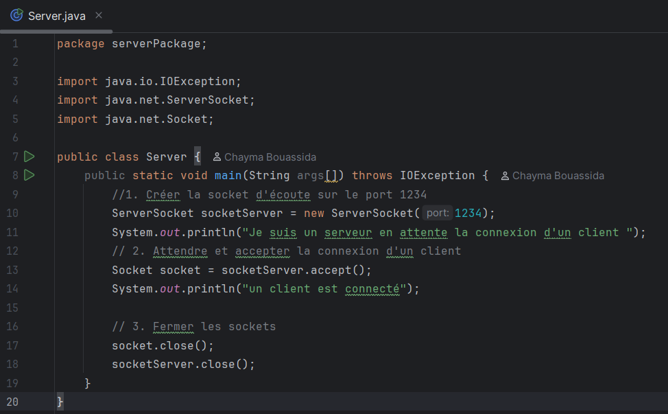
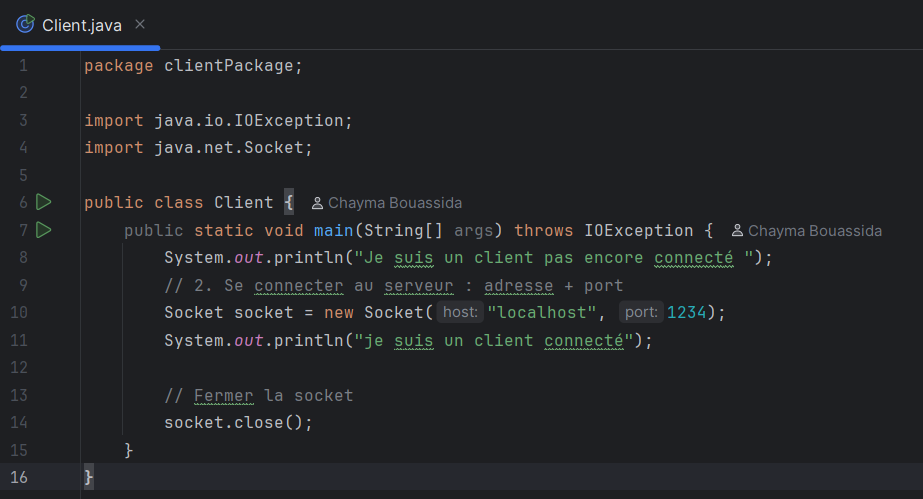
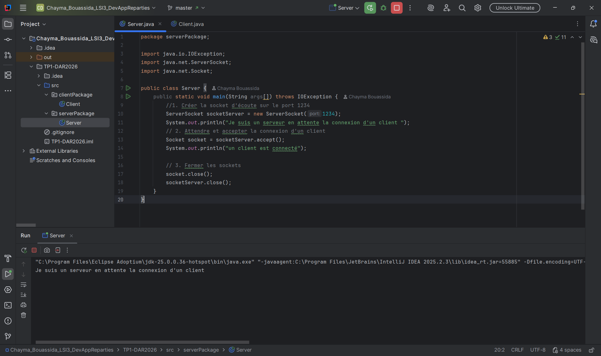
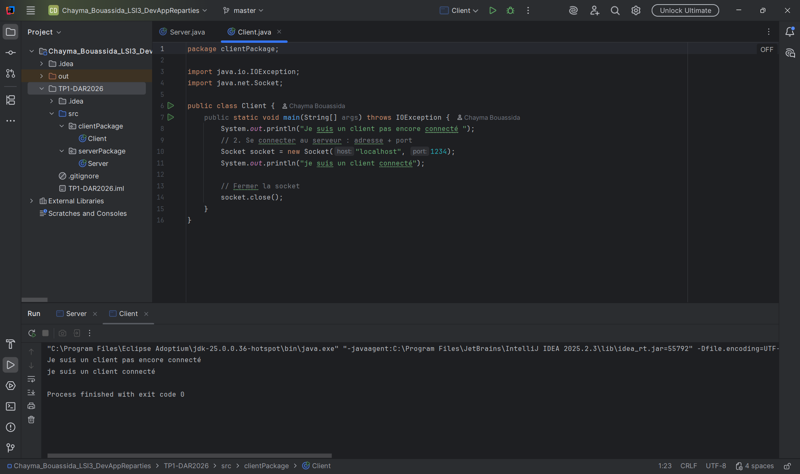
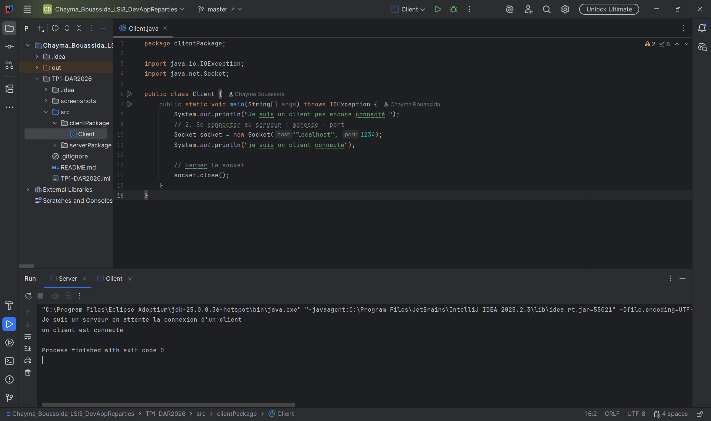
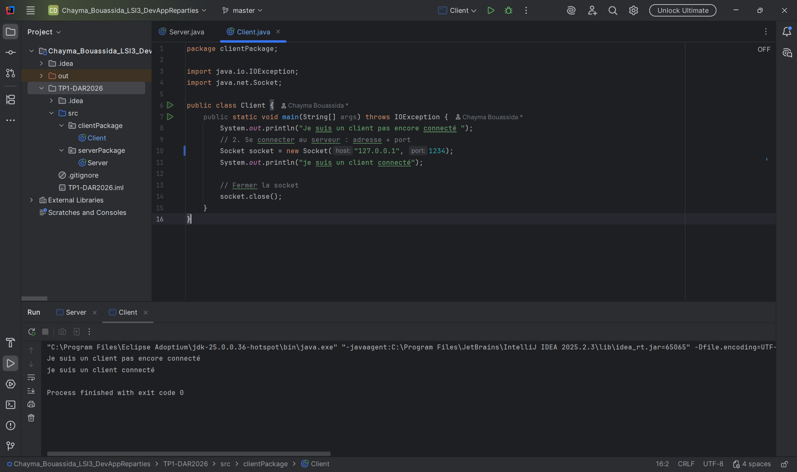

# Activité 1-1 : Première connexion Client/Serveur

## Objectif
Établir une connexion TCP entre un client et un serveur en Java.

## Code
### Server.java

### Client.java

## Exécution
### 1. Serveur en attente

### 2. Client connecté

### 3. Serveur après connexion

## Interprétation
Le serveur démarre, se met en écoute sur le port 1234 et bloque sur `accept()`.
Le client se connecte au serveur via `localhost:1234`.
Dès que la connexion est acceptée, les deux programmes affichent leur message, puis ferment les sockets proprement.

## Test avec une adresse IP
Nous avons remplacé `localhost` par `127.0.0.1`.

Le comportement reste identique : la connexion s'établit correctement.
