# TP1 - Développement d'Applications Réparties (LSI3)

**Étudiant :** Chayma Bouassida  
**Matière :** Développement d'applications réparties  
**Année universitaire :** 2026 – 2027

Ce dépôt contient le travail réalisé pour le TP1 sur les sockets en mode connecté TCP.

---

# Activité 1-1 : Première connexion Client/Serveur

## Objectif
Établir une communication Client/Serveur en Java à l'aide de sockets en mode connecté TCP.

## Code Source
### Server.java

### Client.java

## Exécution et Résultats
### 1. Serveur en attente de connexion
Le serveur démarre, se met en écoute sur le port 1234 et bloque sur `accept()`.

### 2. Client connecté
Le client se connecte au serveur via `localhost:1234` et affiche son message.

### 3. Serveur après connexion
Dès que le client se connecte, le serveur accepte la connexion et affiche le message correspondant.

## Test avec une adresse IP
Nous avons remplacé `localhost` par l'adresse IP `127.0.0.1` dans le client. Le comportement reste identique.

## Interprétation
Le serveur démarre en premier et se bloque sur `accept()` en attendant un client.
Le client initie la connexion. Une fois la connexion TCP établie, les deux programmes affichent leurs messages respectifs, ferment les sockets et se terminent proprement.

---

# Activité 1-2 : Service de calculatrice (x * 5)

## Objectif
Étendre l'application pour que le serveur effectue une multiplication par 5 sur un entier envoyé par le client. Gérer les entiers négatifs et permettre plusieurs requêtes successives jusqu'à ce que l'utilisateur saisisse 0.

## Étape 1 : Version à une seule requête (Server2 / Client2)

### Code Source
#### Server2.java
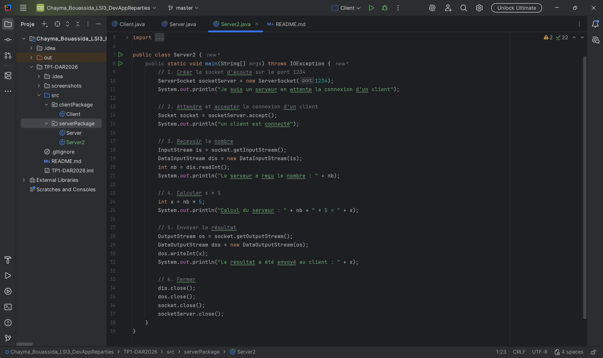

#### Client2.java
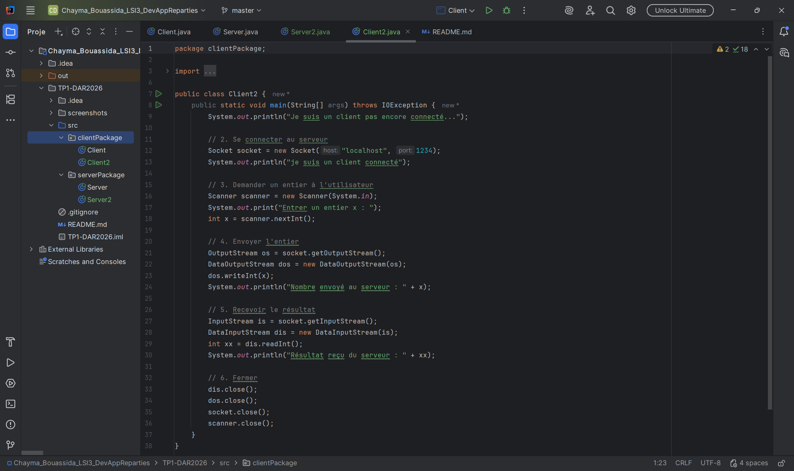

### Tests et Résultats
#### Test avec un entier positif (x = 7)
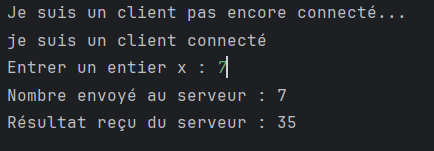
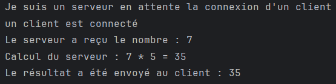

#### Test avec un entier négatif (x = -3)
*Note : L'utilisation de `DataInputStream` et `DataOutputStream` permet de gérer correctement les entiers négatifs (4 octets, signe compris).*
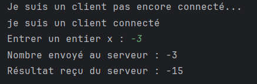
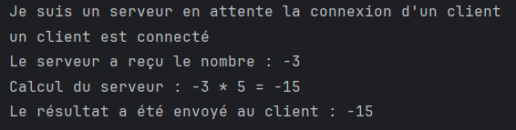

#### Test avec zéro (x = 0)
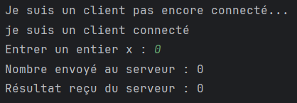
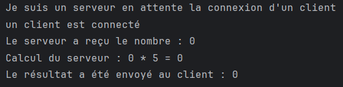

---

## Étape 2 : Version avec boucle (Server3 / Client3)

### Code Source
#### Server3.java
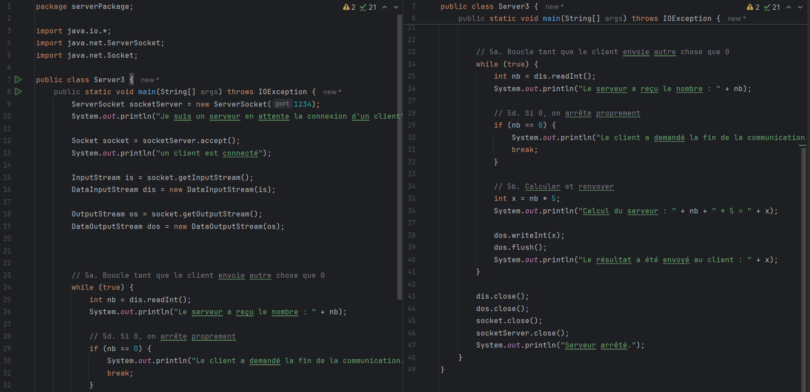

#### Client3.java
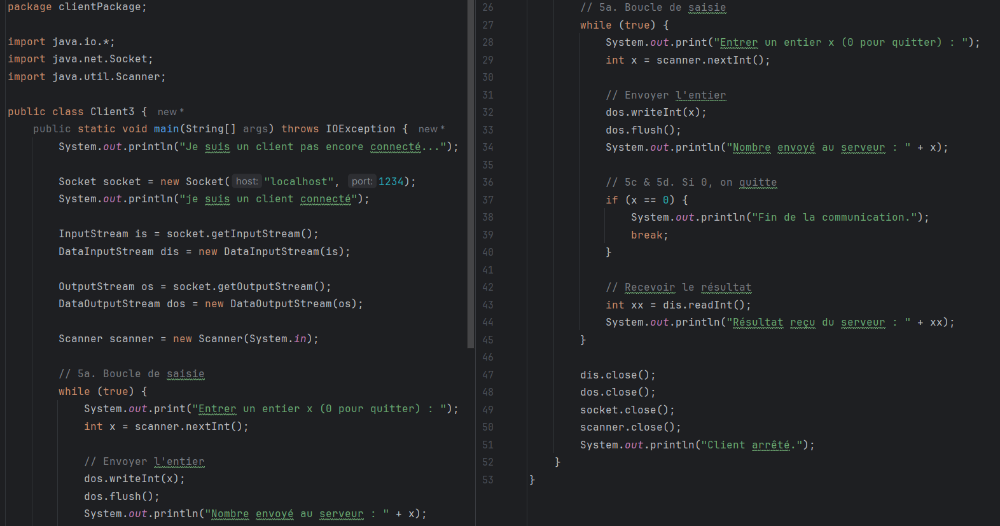

### Test complet (Saisie de 7, puis -3, puis 0 pour quitter)
Le client peut saisir plusieurs entiers successivement. La communication s'arrête proprement lorsque l'utilisateur saisit 0.

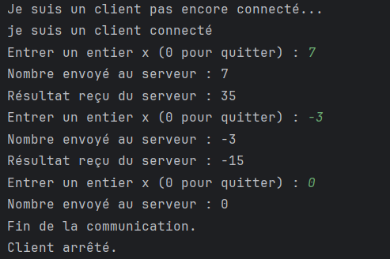
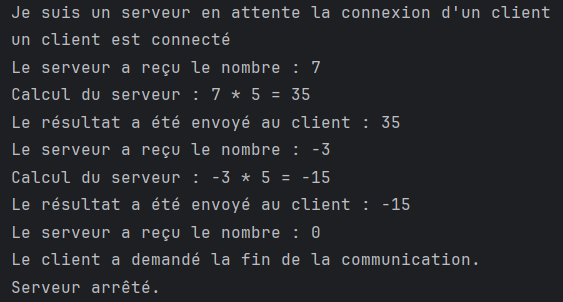

## Interprétation
L'utilisation de `DataInputStream` et `DataOutputStream` permet de transporter correctement les entiers négatifs (4 octets, signe compris).
Dans la version avec boucle, le client peut envoyer plusieurs entiers successivement. Le serveur calcule `x * 5` et renvoie le résultat à chaque fois.
Lorsque le client envoie `0`, les deux boucles s'arrêtent et les sockets sont fermées proprement des deux côtés.