# TP1 - Développement d'Applications Réparties (LSI3)

**Étudiant :** Chayma Bouassida  
**Matière :** Développement d'applications réparties  
**Année universitaire :** 2026 – 2027

Ce dépôt contient le travail réalisé pour le TP1 sur les sockets en mode connecté TCP.

---

# Activité 1-1 : Première connexion Client/Serveur

## Objectif
Établir une communication Client/Serveur en Java à l'aide de sockets en mode connecté TCP.

## Code Source
### Server.java

### Client.java

## Exécution et Résultats
### 1. Serveur en attente de connexion
Le serveur démarre, se met en écoute sur le port 1234 et bloque sur `accept()`.

### 2. Client connecté
Le client se connecte au serveur via `localhost:1234` et affiche son message.

### 3. Serveur après connexion
Dès que le client se connecte, le serveur accepte la connexion et affiche le message correspondant.

## Test avec une adresse IP
Nous avons remplacé `localhost` par l'adresse IP `127.0.0.1` dans le client. Le comportement reste identique.

## Interprétation
Le serveur démarre en premier et se bloque sur `accept()` en attendant un client.
Le client initie la connexion. Une fois la connexion TCP établie, les deux programmes affichent leurs messages respectifs, ferment les sockets et se terminent proprement.

---

# Activité 1-2 : Service de calculatrice (x * 5)

## Objectif
Étendre l'application pour que le serveur effectue une multiplication par 5 sur un entier envoyé par le client. Gérer les entiers négatifs et permettre plusieurs requêtes successives jusqu'à ce que l'utilisateur saisisse 0.

## Étape 1 : Version à une seule requête (Server2 / Client2)

### Code Source
#### Server2.java

#### Client2.java

### Tests et Résultats
#### Test avec un entier positif (x = 7)

#### Test avec un entier négatif (x = -3)
*Note : L'utilisation de `DataInputStream` et `DataOutputStream` permet de gérer correctement les entiers négatifs (4 octets, signe compris).*

#### Test avec zéro (x = 0)

---

## Étape 2 : Version avec boucle (Server3 / Client3)

### Code Source
#### Server3.java

#### Client3.java

### Test complet (Saisie de 7, puis -3, puis 0 pour quitter)
Le client peut saisir plusieurs entiers successivement. La communication s'arrête proprement lorsque l'utilisateur saisit 0.

## Interprétation
L'utilisation de `DataInputStream` et `DataOutputStream` permet de transporter correctement les entiers négatifs (4 octets, signe compris).
Dans la version avec boucle, le client peut envoyer plusieurs entiers successivement. Le serveur calcule `x * 5` et renvoie le résultat à chaque fois.
Lorsque le client envoie `0`, les deux boucles s'arrêtent et les sockets sont fermées proprement des deux côtés.

# Activité 1-3 : Connexion deux machines & Calculatrice améliorée

## Objectif
1. Établir la connexion Client/Serveur entre deux machines distinctes du même réseau local en utilisant `java.net.InetAddress` et `java.net.InetSocketAddress`.
2. Enrichir le service de calculatrice : menu avec Addition, Soustraction, Multiplication, Division.

## Étape 1 : Connexion sur deux machines distinctes

### Architecture du réseau

| Machine | Rôle | Adresse IP | Système |
|---|---|---|---|
| PC Windows | Serveur | `192.168.56.1` | Windows (Host) |
| Ubuntu VM | Client | `192.168.56.102` | Ubuntu 24.04 (VirtualBox) |

- **Réseau :** Host-Only Adapter (`192.168.56.0/24`)
- **Port de communication :** `1234`
- **Classes utilisées :** `InetAddress.getByName()`, `InetSocketAddress`

### Preuve de la configuration réseau
#### Windows Host - ipconfig
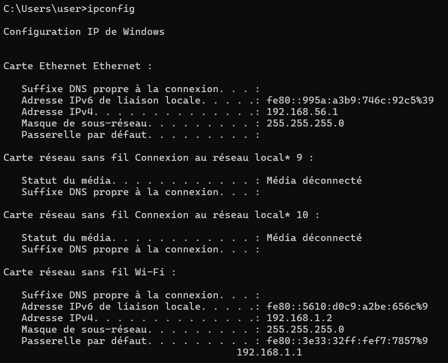

#### Ubuntu VM - ip a
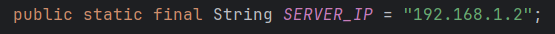

### Connexion établie
#### Serveur en attente (Windows)
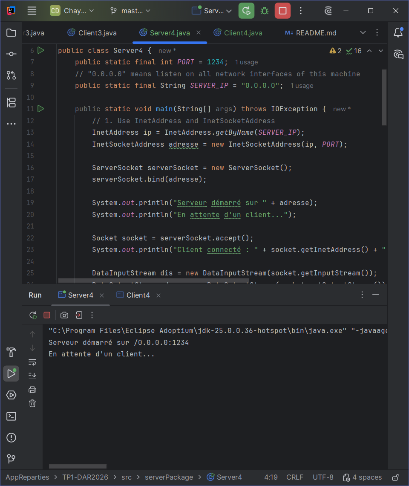

#### Client connecté (VM Ubuntu)
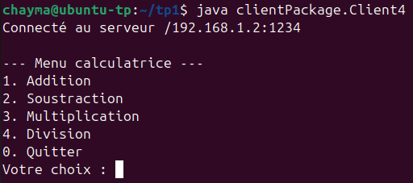

#### Serveur détecte la connexion
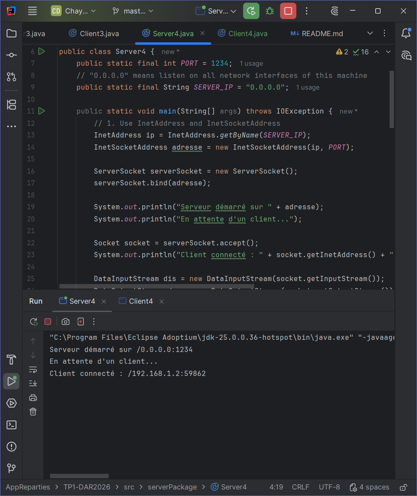

## Étape 2 : Menu calculatrice (Addition, Soustraction, Multiplication, Division)

### Code Source
#### Server4.java
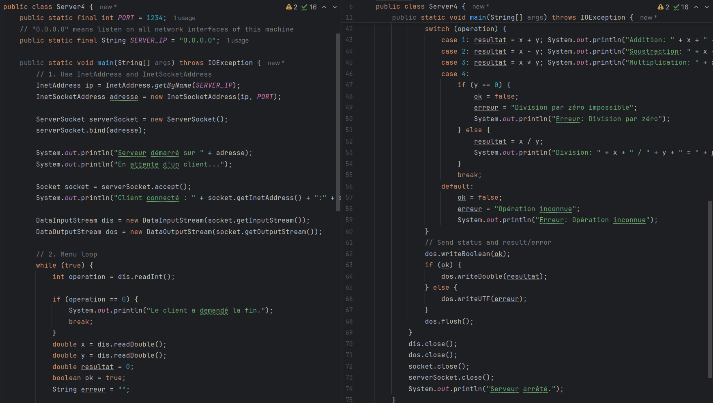

#### Client4.java
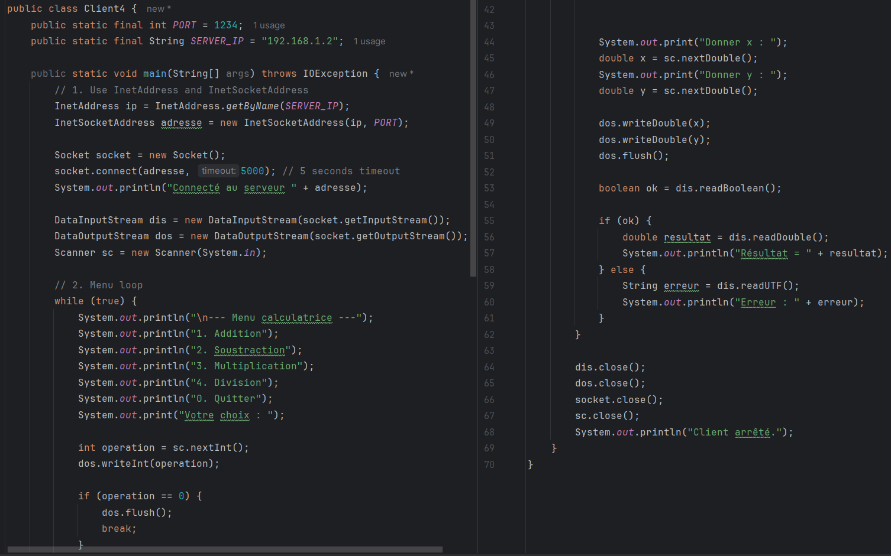

### Tests effectués

#### Test 1 : Addition (5 + 3 = 8.0)
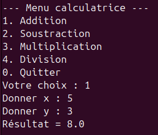

#### Test 2 : Soustraction (10 - 4 = 6.0)
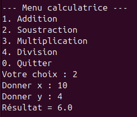

#### Test 3 : Multiplication (6 * 7 = 42.0)
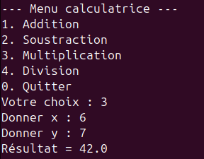

#### Test 4 : Division (5 / 2 = 2.5)
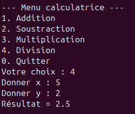

#### Test 5 : Division par zéro (Erreur)
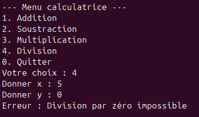

#### Test 6 : Quitter (0)
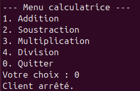

## Interprétation

L'utilisation de `InetAddress` et `InetSocketAddress` a permis de configurer explicitement l'adresse IP et le port de communication. Le serveur écoute sur `0.0.0.0:1234` (toutes les interfaces réseau) tandis que le client se connecte à l'adresse spécifique `192.168.56.1:1234`.

Le protocole de communication a été étendu pour transmettre :
- Un code d'opération (1 à 4)
- Deux opérandes `x` et `y` (double)
- Le serveur renvoie soit un booléen `true` suivi du résultat, soit `false` suivi d'un message d'erreur

Cette architecture permet au client d'enchaîner plusieurs opérations sans fermer la connexion, ce qui est plus efficace qu'une connexion par requête.

## Résultats des tests

| Opération | x | y | Résultat |
|---|---|---|---|
| Addition (1) | 5 | 3 | **8.0** ✅ |
| Soustraction (2) | 10 | 4 | **6.0** ✅ |
| Multiplication (3) | 6 | 7 | **42.0** ✅ |
| Division (4) | 5 | 2 | **2.5** ✅ |
| Division par zéro (4) | 5 | 0 | **Erreur : Division par zéro impossible** ✅ |
| Quitter (0) | — | — | **Client arrêté** ✅ |

Toutes les opérations ont été testées avec succès depuis la VM Ubuntu
(adresse `192.168.56.102`) vers le serveur Windows (adresse `192.168.56.1`).
La communication bidirectionnelle fonctionne correctement pour les entiers
et les décimaux, et la gestion des erreurs (division par zéro) est opérationnelle.